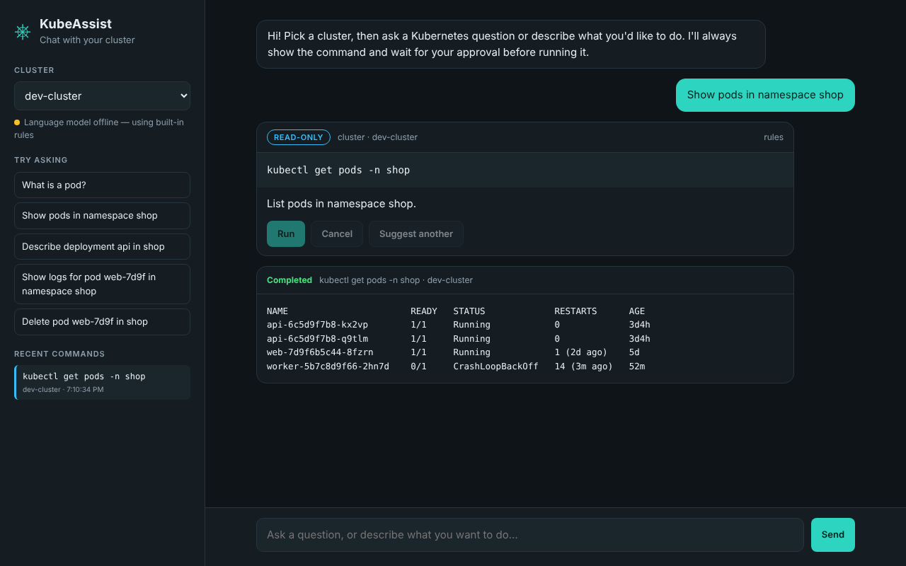
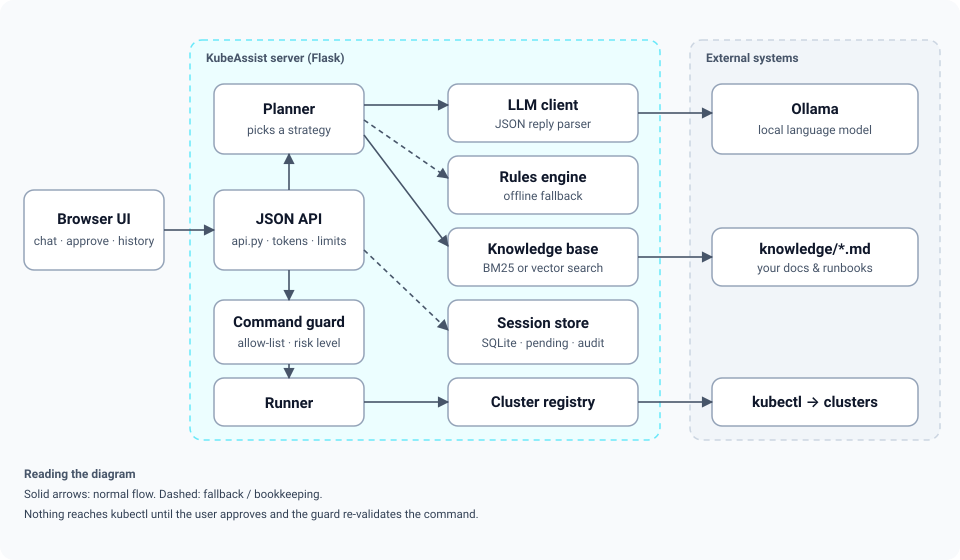
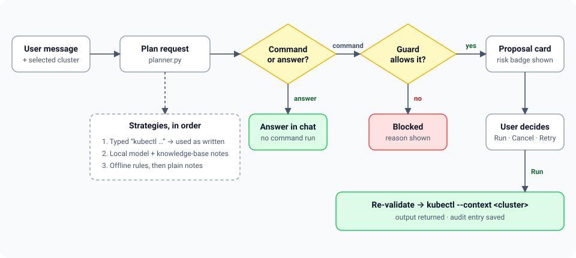
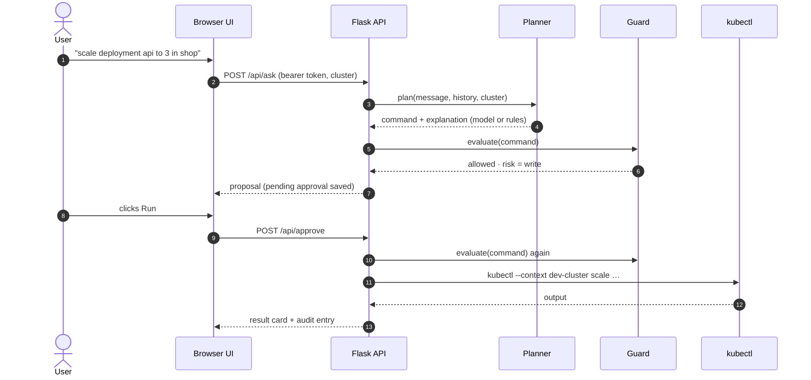
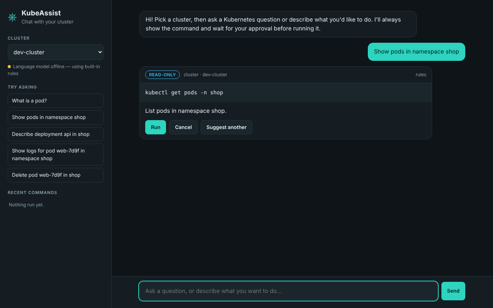
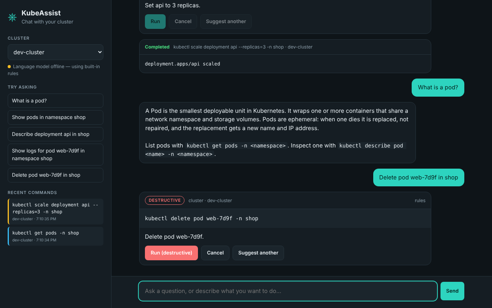
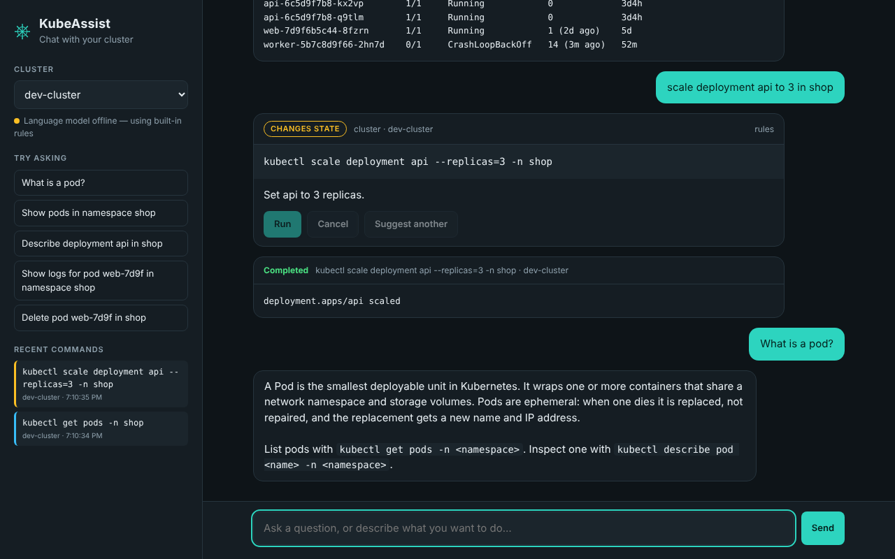
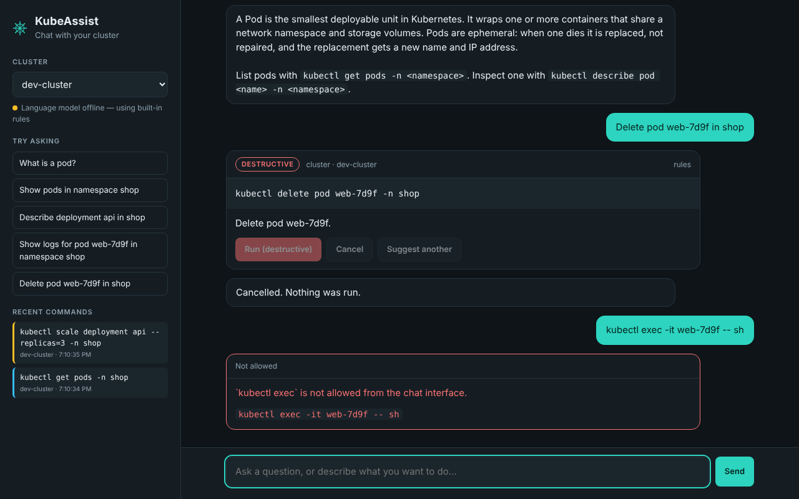
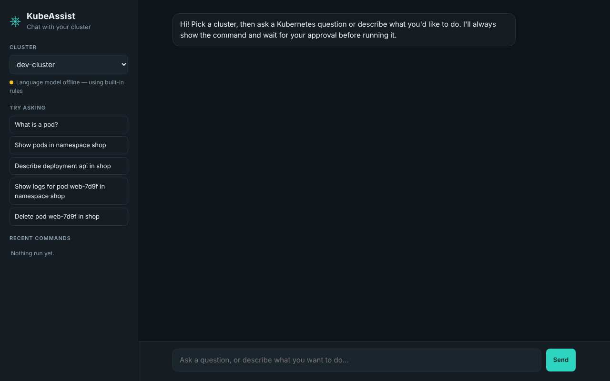
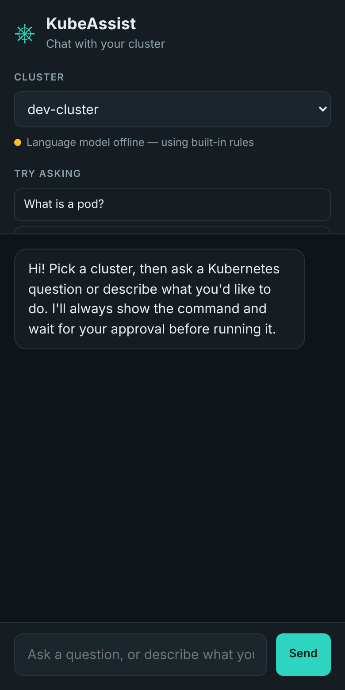

# KubeAssist ChatBot

**Talk to your Kubernetes cluster in plain language — and stay in control of what runs**

KubeAssist is a web app that turns requests like *"show pods in namespace shop"* into `kubectl` commands. It proposes the command, labels how risky it is, and only runs it after you approve. A local language model (via [Ollama](https://ollama.com)) does the translation; if the model is offline, a built-in rules engine keeps the common cases working



## Highlights

| | |
|---|---|
| **Approve before run** | Every command is shown first with a *read-only*, *changes state* or *destructive* badge. Nothing executes until you click **Run** |
| **Works offline** | No model? A rule-based parser handles listing, describing, logs, scaling, restarts, namespace creation and deletes; a knowledge-base search answers concept questions |
| **Grounded answers** | Drop Markdown or text files into `knowledge/` (runbooks, team conventions) and they are retrieved to ground the model's replies |
| **Multi-cluster** | Pick any context from your kubeconfig. The context is passed per command with `--context`, so concurrent users never change each other's target |
| **Guard rails** | An allow-list rejects shells, port-forwards, `--context` overrides, secret dumps, remote manifests and blocking flags |
| **Audit trail** | Each executed command is recorded per session and shown in the sidebar |

## How it works



A request goes through the planner, then the guard, then the user, then the runner:





## Screenshots

| Proposal with risk badge | Destructive action |
|---|---|
|  |  |

| Concept answer from the knowledge base | Blocked command |
|---|---|
|  |  |

<details>
<summary>First screen and mobile layout</summary>

| Desktop | Mobile |
|---|---|
|  |  |

</details>

## Quick start

### Requirements

- Python 3.10+
- `kubectl` on your `PATH` and a kubeconfig with at least one context
- Optional: [Ollama](https://ollama.com) with a model pulled (`ollama pull mistral:instruct`)

### Install and run

```bash
python3 -m venv .venv && source .venv/bin/activate
pip install -r requirements.txt

export KUBEASSIST_SECRET_KEY="$(python3 -c 'import secrets; print(secrets.token_hex(32))')"
python run.py
```

Open <http://127.0.0.1:5000>. Copy `.env.example` if you prefer a file-based configuration.

### Try it without a cluster

The `demo/` folder contains a sample kubeconfig and a fake `kubectl` that prints canned output:

```bash
export KUBEASSIST_KUBECONFIG="$PWD/demo/kubeconfig.yaml"
export KUBEASSIST_KUBECTL_BIN="$PWD/demo/fake_kubectl.sh"
python run.py
```

Then try: *"show pods in namespace shop"*, *"scale deployment api to 3 in shop"*, *"what is a pod?"*, *"delete pod web-7d9f in shop"*

## Configuration

All settings are environment variables with the `KUBEASSIST_` prefix

| Variable | Default | Purpose |
|---|---|---|
| `SECRET_KEY` | random per start | Signs session tokens. **Set it** so sessions survive restarts. |
| `ACCESS_CODE` | *(none)* | If set, the UI asks for this code before issuing a token. |
| `KUBECONFIG` | `~/.kube/config` | Kubeconfig whose contexts are offered in the UI. |
| `KUBECTL_BIN` | `kubectl` from `PATH` | Path to the kubectl binary. |
| `COMMAND_TIMEOUT` | `20` | Seconds before a command is aborted. |
| `LLM_URL` | `http://localhost:11434` | Ollama base URL. |
| `LLM_MODEL` | `mistral:instruct` | Model name. |
| `LLM_TIMEOUT` | `60` | Seconds to wait for the model. |
| `KNOWLEDGE_DIR` | `./knowledge` | Folder of `.md` / `.txt` documents. |
| `DATA_DIR` | `./data` | SQLite database and vector index. |
| `VECTOR_SEARCH` | `0` | Use embeddings instead of keyword search. |
| `EMBEDDING_MODEL` | `all-MiniLM-L6-v2` | Sentence-transformers model for vector search. |
| `RATE_LIMIT_PER_MINUTE` | `30` | Requests per client address. |
| `TOKEN_TTL_HOURS` | `12` | Session token lifetime. |

## HTTP API

All `/api/*` routes except `config` and `token` need `Authorization: Bearer <token>`.

| Method & path | Purpose |
|---|---|
| `GET /api/config` | Clusters, default cluster, whether an access code is required, model status. |
| `POST /api/token` | Issue a session token (`{"access_code": "…"}` if required). |
| `POST /api/ask` | `{"message", "cluster"}` → `answer`, `proposal` or `blocked`. |
| `POST /api/retry` | Ask for a different command than the one pending (rejected ones are passed to the model). |
| `POST /api/approve` | `{"decision": "approve" \| "reject"}` → `result`, `cancelled` or `blocked`. |
| `GET /api/history` | Recent executed commands for this session. |
| `GET /healthz` | Liveness plus cluster count, model reachability and retrieval backend. |

## Project layout

```
kubeassist/
├── kubeassist/
│   ├── __init__.py        # create_app() — wires services together
│   ├── api.py             # routes (blueprint)
│   ├── config.py          # Settings.from_env()
│   ├── security.py        # JWT tokens, login_required, rate limiter
│   ├── planner.py         # chooses: typed command → model → rules → notes
│   ├── llm.py             # Ollama client, prompt builder, reply parser
│   ├── intent.py          # offline rule-based phrase → kubectl parser
│   ├── knowledge.py       # chunking + BM25 / optional vector retrieval
│   ├── guard.py           # command policy and risk classification
│   ├── runner.py          # subprocess execution pinned to a context
│   ├── clusters.py        # kubeconfig context registry
│   ├── store.py           # SQLite: turns, pending command, audit trail
│   ├── templates/         # index.html
│   └── static/            # app.css, app.js
├── knowledge/             # documents used for grounding (edit freely)
├── demo/                  # sample kubeconfig + fake kubectl
├── tests/                 # unittest suite (also runs under pytest)
├── docs/images/           # screenshots and diagrams
├── run.py                 # dev entry point
├── Dockerfile
├── requirements.txt
├── requirements-vector.txt
└── .env.example
```

## Docker

```bash
docker build -t kubeassist .
docker run --rm -p 5000:5000 \
  -e KUBEASSIST_SECRET_KEY=change-me \
  -e KUBEASSIST_LLM_URL=http://host.docker.internal:11434 \
  -v "$HOME/.kube/config:/home/assist/.kube/config:ro" \
  kubeassist
```

The image installs `kubectl`, runs as a non-root user and serves with gunicorn (one worker so the in-memory rate limiter stays accurate)